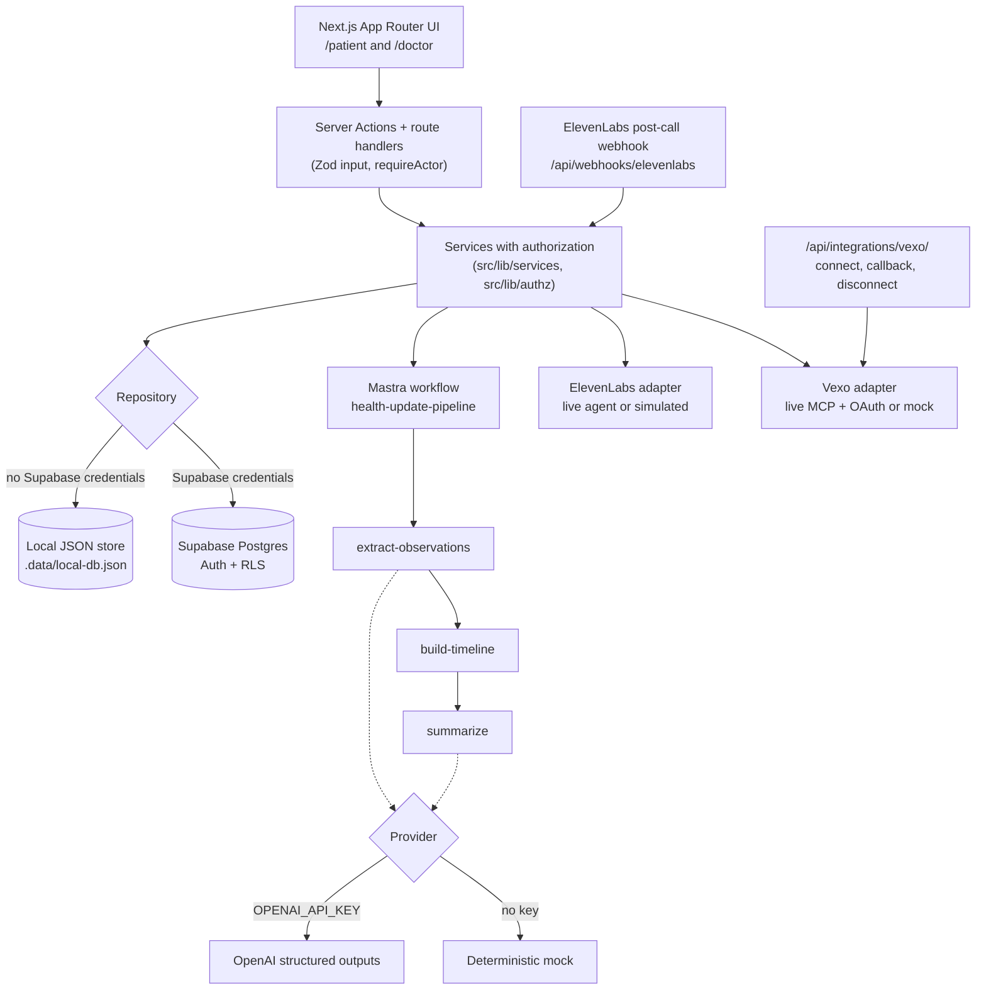
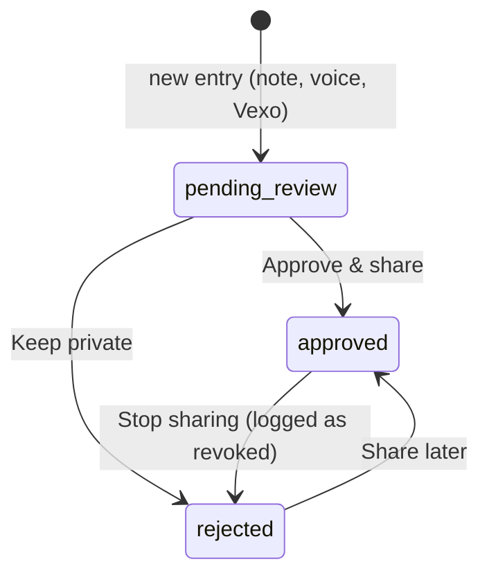

# DoctorLoop AI

Patients capture recovery updates between appointments, using Vexo wearable memories, an ElevenLabs voice check-in, or typed notes. A Mastra workflow backed by OpenAI structures each update into observations. The patient reviews, edits and approves every item before anything is shared. Doctors then see **only patient-approved updates of their assigned patients**, together with an AI pre-visit summary whose statements cite the original records.

> **Scope disclaimer. Please read.**
> DoctorLoop AI is a **hackathon prototype** that uses **synthetic, fictional data only**. Never enter real patient data.
> - It is **not a medical device**.
> - It does **no diagnosis, no triage, no risk scoring** and gives no treatment advice.
> - All AI output is **unverified** and labeled "AI-generated · unverified · needs clinician review".
> - It makes **no HIPAA (or other regulatory) compliance claim**.
> - It is **not for emergencies**. If you need urgent help, call your local emergency number.

---

## Contents

1. [Quick start](#quick-start)
2. [Demo script](#demo-script)
3. [What is real vs simulated](#what-is-real-vs-simulated)
4. [Practice billing (Stripe test mode)](#practice-billing-stripe-test-mode)
5. [Environment variables](#environment-variables)
6. [Architecture](#architecture)
7. [Testing and quality](#testing-and-quality)
8. [Running a production build locally](#running-a-production-build-locally)
9. [Security and privacy notes](#security-and-privacy-notes)
10. [Limitations and next steps](#limitations-and-next-steps)

---

## Quick start

Requires **Node.js 22+**.

```bash
npm install
npm run dev
```

Open <http://localhost:3000> and pick a demo account with the **demo role switcher** (on by default in development only).

This works with **zero credentials**. Every integration falls back to a clearly labeled local substitute:

| Concern | Without credentials |
|---|---|
| Data + auth | Local JSON demo database in `.data/` (`.data/local-db.json`) with signed cookie sessions |
| AI | Deterministic rule-based mock extractor and summarizer, run inside the same Mastra workflow |
| Voice | A labeled "Simulated check-in" scripted text conversation |
| Vexo | A mock adapter with fictional wearable memories |

Optionally copy `.env.example` to `.env.local` and fill in whatever you have (see [Environment variables](#environment-variables)).

**Reset demo data:** open the demo role switcher in the header and choose **Reset demo data**. This control only appears in local-database mode with the switcher enabled. It re-seeds the local database relative to the current time.

---

## Demo script

> **Privacy filter:** every saved update first passes a server-side filter that keeps only health-related sentences and hides other people's names, phones, e-mails, addresses and IDs; removed text is never stored. See [`docs/PRIVACY_FILTER.md`](docs/PRIVACY_FILTER.md).

### Core flow (about 3 minutes)

1. Open <http://localhost:3000> and switch to **Maya Thompson** (patient). You land on `/patient`.
2. Go to **Check-in**. Under **Write an update**, type something, for example: *"My knee has been aching since physio this afternoon. It's about a 6 out of 10. I'll ice it before bed."* Submit it.
3. **AI extraction:** the Mastra pipeline structures the note into observations (symptom, body site, severity only if you stated one, verbatim quotes). The entry appears as **Pending your review**.
4. Click **Review & share**. Edit or remove observations if you like, then click **Approve & share**. (**Keep private** is the alternative. Nothing is shared until you approve.)
5. Use the role switcher to become **Dr. Elena Park**. `/doctor` lists Maya with a "new update" count and the latest shared update.
6. Click **Open Maya Thompson**. The **AI pre-visit summary** is labeled as AI-generated and cites your new entry via source chips.
7. Click a citation. A side sheet shows the **original patient-approved record** with its provenance.
8. Click **Mark reviewed**. The new-update badge clears (or decrements).

### Variants

- **Simulated voice:** in **Check-in**, use **Talk it through** then **Start voice check-in**. Without ElevenLabs credentials it is a scripted, labeled text conversation: answer the prompts with **Send**, then **Finish & save**. The result enters the same review queue as source "voice".
- **Mock Vexo:** open **Import from Vexo**, connect, click **Find health-related memories**, tick the relevant memories, **Import selected**, then review, share and view as the doctor exactly as above. Unrelated memories are filtered out and never stored.
- **Stop sharing:** as Maya, an approved update can be taken back with a confirmation ("Stop sharing this update?"). It disappears from the doctor view and the clinician summary is regenerated from the remaining approved entries.

### Access-control demo

Switch to **Dr. Marcus Bell**. He is assigned only to Priya Raman, so Maya does not appear in his list. Opening Maya's patient URL directly shows a not-found page, never her data. (This is covered by `tests/e2e/access-control.spec.ts`.)

### Demo accounts (from `src/lib/demo/seed.ts`)

All emails use the reserved `example.com` domain. Timestamps are relative to the time of seeding.

| Account | Role | Story |
|---|---|---|
| **Maya Thompson** (`maya.thompson@example.com`) | Patient A | Right knee ACL reconstruction 18 days ago. Self-reported knee discomfort rising 3 to 7/10 over 6 days, sleep falling from about 7h to 4h, physio and crutches. |
| **Daniel Okafor** (`daniel.okafor@example.com`) | Patient B | Left total hip replacement 5 weeks ago. Gradual mobility improvement: walking 10 to 30 min, walker to cane, stiffness 5 to 2/10. |
| **Priya Raman** (`priya.raman@example.com`) | Patient C | Laparoscopic gallbladder removal 12 days ago. Fatigue 7 to 6/10, naps, worried about returning to work and lifting her toddler. |
| **Dr. Elena Park** (`dr.elena.park@example.com`) | Doctor | Post-operative care clinic, assigned to Maya, Daniel and Priya. Primary demo doctor. |
| **Dr. Marcus Bell** (`dr.marcus.bell@example.com`) | Doctor | General surgery, assigned to Priya only (demonstrates access control). |

---

## What is real vs simulated

Each integration has a live implementation in the code. It is used only when credentials are present, and the UI always labels which mode is active. **The live paths have not been exercised without your own credentials**, see [Limitations](#limitations-and-next-steps).

| | Data + auth | AI | Voice | Vexo |
|---|---|---|---|---|
| **Live implementation** | Supabase Postgres + Auth + row-level security (`src/lib/data/supabase`, `supabase/migrations`) | OpenAI structured outputs (Zod-validated) for extraction and summaries, inside the Mastra workflow | ElevenLabs Conversational AI agent, with a signed post-call webhook | MCP over Streamable HTTP with OAuth 2.1 + PKCE, read-only tools (`search`, `get_context`, `get_transcript`) |
| **Mode without credentials** | Local JSON store `.data/local-db.json` | Deterministic rule-based mock | Simulated scripted check-in | Mock adapter, fictional memories |
| **Env vars** | `NEXT_PUBLIC_SUPABASE_URL`, `NEXT_PUBLIC_SUPABASE_PUBLISHABLE_KEY`, `SUPABASE_SECRET_KEY`, `DEMO_ACCOUNT_PASSWORD` | `OPENAI_API_KEY`, `OPENAI_MODEL` (default `gpt-4.1-mini`) | `ELEVENLABS_API_KEY`, `ELEVENLABS_AGENT_ID`, `ELEVENLABS_WEBHOOK_SECRET` | `VEXO_MODE=live`, `VEXO_MCP_URL`, `VEXO_REDIRECT_URI`, optional `VEXO_CLIENT_ID` / `VEXO_CLIENT_SECRET`, `VEXO_SCOPES`, `TOKEN_ENCRYPTION_KEY` (production) |

### Enable Supabase

1. Create a Supabase project (Postgres 15+).
2. Apply `supabase/migrations/20261113000000_doctorloop_init.sql` once, on an empty project (it is not written to be re-run):
   - SQL editor: paste the file and run it, **or**
   - CLI: `npx supabase login`, `npx supabase link --project-ref <ref>`, `npx supabase db push`.
3. In `.env.local` set `NEXT_PUBLIC_SUPABASE_URL`, `NEXT_PUBLIC_SUPABASE_PUBLISHABLE_KEY` (legacy `NEXT_PUBLIC_SUPABASE_ANON_KEY` is also read) and `SUPABASE_SECRET_KEY` (legacy `SUPABASE_SERVICE_ROLE_KEY` is also read; server-only, bypasses RLS).
4. Set `DEMO_ACCOUNT_PASSWORD` (at least 12 characters, no default). It is assigned to every fictional demo account and used by the demo switcher.
5. Seed: `npm run seed:supabase` (idempotent). Add `-- --reset` to delete the demo patients' rows first: `npm run seed:supabase -- --reset`.
6. Restart the dev server. The header shows Supabase as the data mode.

### Enable OpenAI

Set `OPENAI_API_KEY` in `.env.local`. Optionally set `OPENAI_MODEL` (default `gpt-4.1-mini`). The same Mastra workflow now calls OpenAI instead of the mock. Output is re-validated with Zod and post-checked either way.

### Enable ElevenLabs voice

1. Set `ELEVENLABS_API_KEY` in `.env.local`.
2. Run `npm run elevenlabs:create-agent`. It creates the DoctorLoop check-in agent (or updates it if `ELEVENLABS_AGENT_ID` is already set).
3. Put the agent id it prints into `ELEVENLABS_AGENT_ID`.
4. In ElevenLabs, configure a **post-call webhook** to `<your app URL>/api/webhooks/elevenlabs` and put its HMAC secret in `ELEVENLABS_WEBHOOK_SECRET`. The handler verifies the signature and handles `post_call_transcription` events. It needs a publicly reachable URL, so use a tunnel for local testing.
5. The microphone requires `localhost` or HTTPS.

### Enable live Vexo

1. Set `VEXO_MODE=live`. `VEXO_MCP_URL` defaults to `https://api.vexoai.com/mcp`.
2. Set `VEXO_REDIRECT_URI` to `<your app URL>/api/integrations/vexo/callback` (default `http://localhost:3000/api/integrations/vexo/callback`).
3. Optionally set `VEXO_CLIENT_ID` / `VEXO_CLIENT_SECRET` if Vexo issued you a client. Otherwise dynamic client registration is attempted.
4. In production also set `TOKEN_ENCRYPTION_KEY` (required for live Vexo in production).
5. As a patient, open **Import from Vexo** and click **Connect Vexo**.

OAuth facts discovered from Vexo's public metadata (research notes in `src/lib/integrations/vexo/live-adapter.ts`): PKCE with `S256`; dynamic client registration is supported, so `VEXO_CLIENT_ID` is optional; public clients are supported; scope `vexo:read`; RFC 9207 `iss` is returned on the redirect.

**Needs confirmation:** the Vexo tool schemas are only visible after authenticating. The argument names sent to `search`, `get_context` and `get_transcript` (`TOOL_ARGUMENTS`) and the result field names (`FIELD_ALIASES`) are best guesses, isolated in `src/lib/integrations/vexo/live-adapter.ts`, and results are parsed defensively. Adjust them once the real schemas are known.

---

## Practice billing (Stripe test mode)

Every time a patient's input makes the AI work (a check-in is structured, a summary is written), the tokens used are metered and billed to the **doctor's practice, never to the patient**. Doctors get a per-patient usage statement (printable page and CSV) for the practice's own insurance paperwork. It is a usage statement, **not an insurance claim**: no billing codes, no clinical content, synthetic demo data.

| Mode | When | What happens |
|---|---|---|
| **Simulated billing** (default) | No `STRIPE_SECRET_KEY` | In-app checkout with a test card, usage billed instantly, stored simulated invoices (`SIM-0001`, ...) |
| **Stripe test mode** | `STRIPE_SECRET_KEY=sk_test_...` (or `rk_test_...`) | Stripe Checkout, Billing Meters events, real test-mode invoices. Live keys (`sk_live_`, `rk_live_`) are ignored |

The default rate is $0.01 per 1,000 tokens (`BILLING_PRICE_PER_1K_TOKENS_USD`). Mock-AI usage is billed with estimated token counts, labeled as estimated.

**Demo walkthrough (simulated mode)**

1. Sign in as Dr. Park, open **Billing**, click **Set up billing**, and start billing on the simulated checkout page (prefilled test card).
2. Switch to Maya and write a check-in. In Dr. Park's Billing page its usage appears only as "Private processing (not itemized)".
3. As Maya, share the update. It now shows as an itemized "Update structuring" line, together with a "Pre-visit summary" line.
4. As Dr. Park, click **Invoice now (demo)**. A paid `SIM-0001` invoice appears.
5. Open the patient's **Statement**; print or save it as PDF, or download the CSV.

**Privacy**

- Doctors see dated lines only for updates the patient shared and for pre-visit summaries. All other usage (unshared updates, privacy filter, patient summaries) is one undated "Private processing (not itemized)" total per whole UTC calendar month. Billing views never contain entry text, ids or links.
- Stripe receives only the doctor's customer (name, email, `doctorloop_doctor_id`) and token counts. No patient information.
- Patients see one note on their overview that the care team covers the cost and that, for updates they have not shared, the team sees only a monthly total of AI usage. They never see prices or a bill.

**Tomorrow: switching to Stripe test mode**

1. Put `STRIPE_SECRET_KEY=sk_test_...` in `.env.local`.
2. Run `npm run stripe:setup`. It creates (or reuses) the meter `doctorloop_ai_tokens`, the metered price and a Customer Portal configuration, and prints their ids.
3. Restart the dev server.
4. Billing, **Set up billing**: Stripe Checkout opens. Use test card `4242 4242 4242 4242`, any future expiry, any CVC.
5. Patient activity now sends meter events (Stripe Dashboard, Billing, Meters).
6. **Invoice now (demo)** closes the period and creates a real test-mode invoice. Usage from the last few minutes may land on the next invoice.
7. Optional webhooks for status sync: run `stripe listen --forward-to localhost:3000/api/webhooks/stripe` and put the printed `whsec_...` in `STRIPE_WEBHOOK_SECRET`. The app also re-reads the subscription status when the Billing page loads, so webhooks are optional.
8. A simulated billing account does not carry over. Set up billing again in Stripe mode. Use **Reset demo data** after switching from simulated to Stripe mode to start clean.

Checklist for the first Stripe test:

- Browse at exactly `NEXT_PUBLIC_APP_URL` (default `http://localhost:3000`). Checkout success/cancel and Customer Portal return URLs use it, and the session cookie is host-only.
- Run `stripe listen --forward-to localhost:3000/api/webhooks/stripe` during the first test (recommended). The Billing page also self-heals a pending setup now.
- Restricted `rk_test_` keys need write access to Billing Meters and Meter Events, Products and Prices, Customers, Checkout Sessions, Subscriptions, Invoices and the Customer Portal.
- Switching Stripe accounts or wiping test data leaves the local account pointing at missing objects. Use **Reset demo data** (local mode) or `npm run seed:supabase`.
- At the default $0.01 per 1,000 tokens a demo period costs cents, below Stripe's minimum charge, so the invoice may be carried to the customer balance instead of charging the card. For the demo set `BILLING_PRICE_PER_1K_TOKENS_USD=1` before `npm run stripe:setup` (it creates a matching price). Stripe also creates a $0 invoice when the subscription starts.
- **Invoice now (demo)**: usage sent in the last few minutes may be missing from that invoice (Stripe processes meter events asynchronously). Verify the invoice.
- In the Customer Portal, cancellation is immediate. Use **Invoice now (demo)** first so the period's usage is invoiced.

**Known limitations**

- Test mode only. ElevenLabs voice minutes are not metered.
- Usage recorded before billing is set up is never billed. Failed Stripe syncs can be retried for 23 hours.
- Per-patient monthly totals update as usage happens, so a doctor could notice that a patient used AI processing privately around a particular time. They never see which update or its content. Next step: show per-patient private totals only for closed months.
- In Supabase mode usage is read without pagination (fine at demo scale).

**Tests:** billing unit tests under `tests/billing`, `tests/services/billing-*.test.ts` and `tests/integrations/stripe.test.ts`, plus the Playwright spec `tests/e2e/billing-flow.spec.ts`. The e2e setup (`playwright.config.ts`, and `scripts/test-run.mjs` for the whole-app run) blanks `STRIPE_SECRET_KEY` so a key in `.env.local` never leaks into test runs.

---

## Environment variables

Every variable is optional for local demos. Source of truth: `.env.example` and `src/lib/config/env.ts`.

| Variable | Default / behavior | Needed when |
|---|---|---|
| `NEXT_PUBLIC_APP_URL` | `http://localhost:3000` | Deployed (and for webhook / redirect URLs) |
| `SESSION_SECRET` | Dev: random secret auto-created in `.data/dev-session-secret` | **Required in production**, at least 32 characters (app refuses to run otherwise). Generate with `openssl rand -base64 48` |
| `TOKEN_ENCRYPTION_KEY` | Derived from `SESSION_SECRET` via HKDF with a separate label | **Required when `VEXO_MODE=live` in production** |
| `ENABLE_DEMO_ROLE_SWITCHER` | On in development, **off in production** | Set `true` only for synthetic-data demo deployments: it lets anyone sign in as the fictional accounts |
| `NEXT_PUBLIC_SUPABASE_URL` | Empty: local JSON demo DB | Supabase mode |
| `NEXT_PUBLIC_SUPABASE_PUBLISHABLE_KEY` | Empty (`sb_publishable_...` or legacy anon key) | Supabase mode |
| `SUPABASE_SECRET_KEY` | Empty (`sb_secret_...` or legacy service-role key). Server-only, bypasses RLS | Supabase mode |
| `DEMO_ACCOUNT_PASSWORD` | No default, at least 12 characters | Seeding Supabase and using the switcher in Supabase mode |
| `OPENAI_API_KEY` | Empty: mock AI | Real AI |
| `OPENAI_MODEL` | `gpt-4.1-mini` | Optional |
| `ELEVENLABS_API_KEY` | Empty: simulated check-in | Live voice, `npm run elevenlabs:create-agent` |
| `ELEVENLABS_AGENT_ID` | Empty | Live voice |
| `ELEVENLABS_WEBHOOK_SECRET` | Empty | Post-call webhook verification |
| `VEXO_MODE` | `mock` (`live` enables the real connector) | Live Vexo |
| `VEXO_MCP_URL` | `https://api.vexoai.com/mcp` | Optional |
| `VEXO_CLIENT_ID`, `VEXO_CLIENT_SECRET` | Empty: dynamic client registration is attempted | Only if Vexo issues you a client |
| `VEXO_SCOPES` | `vexo:read` | Optional |
| `VEXO_REDIRECT_URI` | `http://localhost:3000/api/integrations/vexo/callback` | Must match your deployed URL |
| `STRIPE_SECRET_KEY` | Empty: simulated billing. Only `sk_test_` / `rk_test_` keys are used | Stripe test-mode billing, `npm run stripe:setup` |
| `STRIPE_WEBHOOK_SECRET` | Empty (webhook returns 503) | Optional status sync via `stripe listen` |
| `BILLING_PRICE_PER_1K_TOKENS_USD` | `0.01` | Optional |

Other variable seen in code and tests: `DOCTORLOOP_LOCAL_DB_PATH` overrides the local DB file (`:memory:` for no disk I/O).

---

## Architecture



### The AI pipeline

The Mastra workflow `health-update-pipeline` (`src/mastra/workflows/health-update.ts`) runs three steps: `extract-observations`, then `build-timeline`, then `summarize`. Extraction and summaries use OpenAI structured outputs when `OPENAI_API_KEY` is set, and a deterministic mock otherwise. All model output is re-validated with Zod (`src/lib/ai/schemas.ts`) and post-checked in `src/lib/ai/postprocess.ts`: patient quotes must be **verbatim**, severity is kept only if **explicitly stated**, and every summary **citation must reference a real input entry**. The timeline is built deterministically (`src/lib/ai/timeline.ts`).

### Folder map

```
src/
  app/            Routes: /, /login, /patient/{check-in,timeline,review,import,summary},
                  /doctor, /doctor/patients/[patientId], api/webhooks/elevenlabs,
                  api/integrations/vexo/{connect,callback,disconnect}, actions/
  components/     ui (shadcn), app-shell, shared, patient, doctor, voice, vexo
  lib/
    domain/       Domain types and view models
    ai/           Pipeline, Zod schemas, post-checks, timeline, mock/ and openai/ providers
    authz/        Pure authorization predicates (mirror the RLS rules)
    auth/         Sessions (signed cookie / Supabase), demo accounts
    data/         Repository interface; local/ (JSON) and supabase/ implementations
    services/     patient, doctor, ingest, summaries, voice, vexo, views
    integrations/ elevenlabs/ and vexo/ (adapters, OAuth, crypto)
    supabase/     Server, browser and admin clients, session refresh
    demo/         Synthetic seed data and demo accounts
    config/env.ts Server config, feature detection, integration status
  mastra/         Mastra instance and workflows
  proxy.ts        Supabase session refresh (Next.js proxy)
supabase/         Migration and setup README
scripts/          seed-supabase.ts, elevenlabs-create-agent.ts
tests/            ai, authz, db (PGlite RLS), integrations, seed, services, e2e (Playwright)
docs/             ARCHITECTURE.md (build contract), PRODUCT_SPEC.md
```

### Data model

Tables in `supabase/migrations/20261113000000_doctorloop_init.sql`: `profiles`, `patient_profiles`, `care_assignments`, `source_references`, `voice_sessions`, `journal_entries`, `observations`, `generated_summaries`, `sharing_approvals`, `doctor_reviews`, `vexo_connections`. The local JSON store mirrors the same entities.

### Access model

- **Patients** own their data: they read all of their own entries, and edit body, time or observations only while an entry is `pending_review`.
- **Doctors** read **only `approved` entries** (and active observations) of **assigned** patients, plus the `clinician` audience summary. Voice transcripts and sharing approvals are patient-only.
- **System-only writes:** observations, generated summaries, sharing approval rows, source references, processing status and Vexo connections are written only by the system repository after an explicit authorization check.
- **No free text in source references:** `excerpt` is always `null` for new rows. Provenance lives in `metadata`, and the entry `body` is the only patient text that can ever be shared. Doctor views strip excerpts and keep whitelisted metadata only.
- **Superseded summaries are hidden:** doctors can read only the newest clinician summary per patient.
- The same rules are enforced twice: in code (`src/lib/authz/policies.ts`, local repository) and in Postgres RLS.

### Consent flow



Every transition writes a `sharing_approvals` row and regenerates the clinician summary from approved entries only. Doctors "mark reviewed" on approved entries; "awaiting review" means unread shared updates and is explicitly **not** a risk score.

---

## Testing and quality

```bash
npm run typecheck   # tsc --noEmit
npm run lint        # eslint
npm test            # Vitest (vitest run)
npm run build       # next build
npm run test:e2e    # Playwright
```

- **Vitest:** unit, service and PGlite RLS tests. Latest run: **15 test files, 181 tests passed** (`npx vitest run`). Layout: `tests/ai`, `tests/authz`, `tests/db` (applies the real migration to in-process Postgres), `tests/integrations`, `tests/seed`, `tests/services`.
- **Playwright e2e** (`tests/e2e`: text flow, voice flow, Vexo flow, access control, screenshots):
  ```bash
  npx playwright install chromium
  npm run build
  npm run test:e2e
  ```
  The config starts its own production server with `npm run start -- -p 3100` (reusing one if already running), using its own database `.data/e2e-db.json`, the demo switcher enabled and a test-only `SESSION_SECRET`.

---

### Test run (whole-app rehearsal)

`npm run test:run` builds an isolated copy, replays a Vexo band file and walks the full demo in a real browser
(typed and voice check-ins, band import, review, doctor view, access control), saving a screenshot per step, a
video and an HTML report. See [docs/TEST_RUN.md](docs/TEST_RUN.md) for flags, a manual click-through checklist and
troubleshooting.

## Running a production build locally

```bash
SESSION_SECRET="$(openssl rand -base64 48)" npm run build && SESSION_SECRET="..." npm start
```

- `SESSION_SECRET` (at least 32 characters) is **required** in production.
- The demo role switcher is **off** in production unless `ENABLE_DEMO_ROLE_SWITCHER=true`. Enable it only for synthetic-data demos.
- The local JSON store is **single-process and not suitable for serverless**. Use Supabase when deploying.
- Live Vexo in production additionally needs `TOKEN_ENCRYPTION_KEY`.

---

## Security and privacy notes

- **Server-side authorization everywhere:** Server Actions derive the actor from the session (never from client-supplied ids), and services re-check authorization before touching data.
- **Row-level security** on every table; `anon` has no access. The secret key stays server-only, and only the Supabase URL, publishable key and app URL reach the browser.
- **OAuth tokens** for Vexo are encrypted at rest with **AES-256-GCM** (the user id as AAD) using **HKDF-derived** per-purpose keys.
- **OAuth hardening:** PKCE (`S256`), a `state` check, and an RFC 9207 `iss` check on the callback; the in-flight OAuth state is carried in a short-lived encrypted cookie.
- **Signed webhooks:** the ElevenLabs post-call webhook reads the raw body and verifies the HMAC signature; unsigned or invalid requests are rejected. Live conversations are bound to the server-created voice session.
- **Patient approves every item** before a doctor can see it, and can stop sharing at any time.
- **Vexo privacy:** only read-only tools are allowed, unrelated memories are filtered by a relevance check and never stored, and imports re-fetch each item to verify provenance.
- Sessions use an httpOnly, signed, `sameSite=lax` cookie (`secure` in production) in local mode, and Supabase Auth in Supabase mode.

---

## Limitations and next steps

**Known limitations**

- The mock AI is rule-based. Its extraction and summary quality is limited to its lexicon and is only a stand-in for a real model.
- The live integrations (Supabase, OpenAI, ElevenLabs, Vexo) are implemented but were not exercised without credentials; treat them as unverified until you run them with your own accounts.
- The Vexo tool argument names and result shapes are unconfirmed (see above).
- Timeline day grouping uses a single timezone rather than per-user time zones.
- There are no notifications; doctors must open the app to see new updates.
- The local JSON store is single-process.

**What a real deployment would require**

- Privacy and security review, threat modeling and penetration testing.
- Clinical governance and clinician validation of AI output and safety behavior.
- Regulatory assessment (including whether the software would be a medical device in your jurisdiction).
- HIPAA/GDPR-style compliance work, including business associate agreements (BAAs) or data processing agreements with every vendor (Supabase, OpenAI, ElevenLabs, Vexo).
- Audit logging, monitoring and alerting, backup and retention policies.
- Real identity, account provisioning and care-team assignment instead of demo accounts.
- Consent, data-subject rights and deletion workflows.
- Production hosting with Supabase (not the local JSON store) and secret management.
